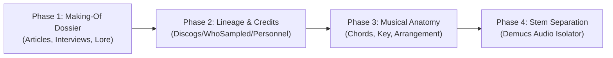

# Deep Song Explorer 🎵🔍

A deep, tactically rich music exploration and analysis tool designed to satisfy the obsession of digging into the anatomy, creative process, and history of songs.

---

## 🧭 Project Roadmap



### **Phase 1: The "Making-Of" Dossier (Current Sprint)**
- **Focus:** Curating high-signal articles, studio session notes, oral histories, gear breakdowns, and trivia for any song.
- **Sources:** Targeted queries across production publications (*Sound on Sound*, *Tape Op*, *Mix Online*), oral histories (*Pitchfork*, *Rolling Stone*, *Stereogum*), and artist notes (*Genius*, interview transcripts).
- **Deliverable:** Structured song dossiers with creative spark, studio craft, gear lore, key quotes, and verified source links.

### **Phase 2: Lineage & Credits Engine**
- **Personnel & Credits:** Studio engineers, producers, session musicians, guest features via Discogs / MusicBrainz.
- **Sample Lineage:** What the track sampled, who sampled it, and direct interpolations.

### **Phase 3: Structural & Musical Anatomy**
- Musical key, BPM, chord progressions, and arrangement visualizer (Intro / Verse / Chorus / Bridge / Outro).
- Audio feature extraction and waveform dynamics.

### **Phase 4: Interactive Stem Separation & Visualizer (Zenith Tier)**
- AI stem separation (Vocals, Drums, Bass, Other) powered by local models (e.g., Demucs).
- Interactive multi-track player with individual stem solo/mute capabilities.

---

## 📂 Architecture

```text
Deep-Song-Explorer/
├── GEMINI.md               # Workspace rules & partner philosophy
├── README.md               # Project overview & roadmap
├── requirements.txt        # Minimal, zero-bloat dependencies
├── backlog/
│   └── backlog.md          # Parked ideas, future phases, and enhancements
├── data/                   # Cached dossiers, metadata, and search caches
├── song_explorer/          # Core Python package
│   ├── __init__.py
│   ├── config.py           # Settings and search domain presets
│   └── articles/           # Phase 1: Article finder & dossier builder
│       ├── __init__.py
│       ├── models.py       # Dataclasses: Song, Article, SongDossier
│       ├── search.py       # High-intent targeted search query engine
│       └── extractor.py    # Article parsing, quote & trivia extractor
└── tests/                  # Unit and integration test suite
```

---

## 🚀 Quickstart

### Prerequisites
- Python 3.10+

### Setup
```bash
pip install -r requirements.txt
```
