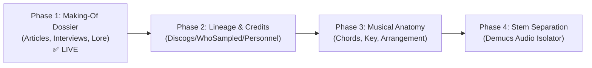

# Deep Song Explorer 🎵🔍

A deep, tactically rich music exploration and analysis tool designed to satisfy the obsession of digging into the anatomy, creative process, and history of songs.

---

## 🧭 Project Roadmap



### **Phase 1 & 1.2: Making-Of Dossier & Studio Sanctuary (Status: ✅ LIVE)**
- **Focus:** Curating deep-dive articles, studio session notes, oral histories, album timelines, and studio lineage.
- **Engine:** Dual-Tier Search (concurrent song deep dives + album retrospectives) via `ddgs` with zero API keys required.
- **Auto-Resolution:** MusicBrainz integration for canonical track correction (e.g. *"Paradise Circle"* → *"Paradise Circus"*) and studio album identification.
- **Album Context & Timeline:** Chronological discography timeline displaying 3 preceding and 3 successor studio albums with release dates and AllMusic ratings.
- **Studio Sanctuary & Heritage:** Recording facility and location, career narrative why chosen, prior landmark albums, contemporary era peers, and producer pedigree with milestone works.
- **Gen AI Chat Assistant:** Interactive terminal assistant grounded in the compiled dossier and scraped articles.

### **Phase 2: Lineage & Credits Engine (Inspired by Spotify SongDNA)**
- **Personnel & Credits:** Studio engineers, producers, session musicians, guest features via Discogs / MusicBrainz.
- **Sample Lineage:** WhoSampled integration tracing direct samples, covers, and who sampled the track.

### **Phase 3: Structural & Musical Anatomy**
- Musical key, BPM, chord progressions, and arrangement visualizer (Intro / Verse / Chorus / Bridge / Outro).
- Audio feature extraction and waveform dynamics.

### **Phase 4: Interactive Stem Separation & Visualizer (Zenith Tier)**
- AI stem separation (Vocals, Drums, Bass, Other) powered by local models (e.g., Demucs).
- Interactive multi-track player with individual stem solo/mute capabilities.

---

## 📂 Architecture

```text
Deep-Song-Explorer/
├── GEMINI.md               # Workspace rules & partner philosophy
├── README.md               # Project overview & roadmap
├── explore                 # Executable CLI launcher script
├── requirements.txt        # Minimal, zero-bloat dependencies
├── backlog/
│   └── backlog.md          # Parked ideas, future phases, and enhancements
├── data/
│   └── cache/              # Instant local cache for compiled dossiers (JSON)
├── song_explorer/          # Core Python package
│   ├── __init__.py
│   ├── config.py           # Settings and search domain presets
│   ├── cli.py              # Rich terminal interface & interactive prompt
│   ├── chat.py             # Phase 1.2: Interactive Gen AI Chat Assistant
│   ├── metadata/           # MusicBrainz resolver & AllMusic ratings
│   │   ├── __init__.py
│   │   └── musicbrainz.py
│   └── articles/           # Article finder, studio heritage & synthesizer
│       ├── __init__.py
│       ├── models.py       # Dataclasses: Song, Article, SongDossier, StudioHeritage
│       ├── search.py       # Dual-Tier search (song deep-dives + album lore)
│       ├── extractor.py    # Article parsing & quote extractor
│       ├── studios.py      # Studio Sanctuary & landmark lineage database
│       ├── producers.py    # Producer pedigree & collaborator resolver
│       └── synthesizer.py  # Lore synthesizer & cache manager
└── tests/                  # Automated unit and integration test suite
    └── test_sprint_a.py    # Phase 1.2 test suite
```

---

## 🚀 Quickstart & Usage

### Prerequisites
- Python 3.10+ (tested on Python 3.13)

### Installation
```bash
# 1. Create and activate virtual environment
python3 -m venv .venv
source .venv/bin/activate

# 2. Install lightweight dependencies
pip install -r requirements.txt
```

### Running the Explorer

#### 1. Direct Command
Run `./explore` with the artist and song title:
```bash
./explore "Steely Dan" "Deacon Blues"
./explore "Fleetwood Mac" "Dreams"
./explore "Radiohead" "Paranoid Android"
```

#### 2. Interactive Mode
Run `./explore` with no arguments to get an interactive prompt:
```bash
./explore
# 👤 Enter Artist Name: 
# 🎵 Enter Song Title:  
```

#### 3. Bypass Local Cache
Forces a fresh web search and re-synthesis:
```bash
./explore "Steely Dan" "Deacon Blues" --no-cache
```

#### 4. Mobile PWA & Web Server
Launch the mobile web server locally:
```bash
./explore serve
```
Open `http://localhost:8000` in your browser. On mobile devices (iOS Safari or Android Chrome), tap **"Add to Home Screen"** to install as a standalone full-screen native-feeling app!

#### 5. Render 1-Click Cloud Deployment
The repository includes `render.yaml` for instant deployment on [Render](https://render.com):
- **Runtime:** Python 3
- **Build Command:** `pip install -r requirements.txt`
- **Start Command:** `uvicorn song_explorer.server:app --host 0.0.0.0 --port $PORT`
- **Env Vars (Optional):** `GEMINI_API_KEY` for Google Gemini AI (DuckDuckGo AI chat fallback is zero-config out-of-the-box).
