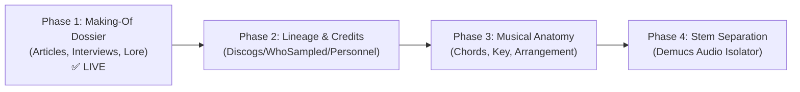

# Deep Song Explorer 🎵🔍

A deep, tactically rich music exploration and analysis tool designed to satisfy the obsession of digging into the anatomy, creative process, and history of songs.

---

## 🧭 Project Roadmap



### **Phase 1: The "Making-Of" Dossier (Status: ✅ LIVE)**
- **Focus:** Curating high-signal articles, studio session notes, oral histories, gear breakdowns, and trivia for any song.
- **Engine:** 2-tier search (curated gold-standards + open-web intent filtering) via `ddgs` with zero API keys required.
- **Synthesizer:** Automatically extracts creative origins, studio recording lore, detected gear (*Rhodes*, *Neumann*, *Studer*, *Moog*), key quotes, and verified source links.
- **Interface:** High-visibility Rich terminal CLI (`./explore`) with sub-second local disk caching (`data/cache/`).

### **Phase 2: Lineage & Credits Engine**
- **Personnel & Credits:** Studio engineers, producers, session musicians, guest features via Discogs / MusicBrainz.
- **Sample Lineage:** What the track sampled, who sampled it, and direct interpolations.

### **Phase 3: Structural & Musical Anatomy**
- Musical key, BPM, chord progressions, and arrangement visualizer (Intro / Verse / Chorus / Bridge / Outro).
- Audio feature extraction and waveform dynamics.

### **Phase 4: Interactive Stem Separation & Visualizer (Zenith Tier)**
- AI stem separation (Vocals, Drums, Bass, Other) powered by local models (e.g., Demucs).
- Interactive multi-track player with individual stem solo/mute capabilities.

---

## 📂 Architecture

```text
Deep-Song-Explorer/
├── GEMINI.md               # Workspace rules & partner philosophy
├── README.md               # Project overview & roadmap
├── explore                 # Executable CLI launcher script
├── requirements.txt        # Minimal, zero-bloat dependencies
├── backlog/
│   └── backlog.md          # Parked ideas, future phases, and enhancements
├── data/
│   └── cache/              # Instant local cache for compiled dossiers (JSON)
├── song_explorer/          # Core Python package
│   ├── __init__.py
│   ├── config.py           # Settings and search domain presets
│   ├── cli.py              # Rich terminal interface & interactive prompt
│   └── articles/           # Phase 1: Article finder & dossier builder
│       ├── __init__.py
│       ├── models.py       # Dataclasses: Song, Article, SongDossier
│       ├── search.py       # 2-Tier targeted query search engine
│       ├── extractor.py    # Article parsing, quote & gear extractor
│       └── synthesizer.py  # Lore synthesizer & cache manager
└── tests/                  # Unit and integration test suite
```

---

## 🚀 Quickstart & Usage

### Prerequisites
- Python 3.10+ (tested on Python 3.13)

### Installation
```bash
# 1. Create and activate virtual environment
python3 -m venv .venv
source .venv/bin/activate

# 2. Install lightweight dependencies
pip install -r requirements.txt
```

### Running the Explorer

#### 1. Direct Command
Run `./explore` with the artist and song title:
```bash
./explore "Steely Dan" "Deacon Blues"
./explore "Fleetwood Mac" "Dreams"
./explore "Radiohead" "Paranoid Android"
```

#### 2. Interactive Mode
Run `./explore` with no arguments to get an interactive prompt:
```bash
./explore
# 👤 Enter Artist Name: 
# 🎵 Enter Song Title:  
```

#### 3. Bypass Local Cache
Forces a fresh web search and re-synthesis:
```bash
./explore "Steely Dan" "Deacon Blues" --no-cache
```
